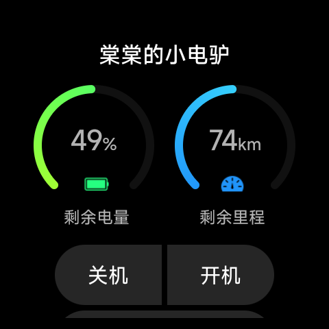
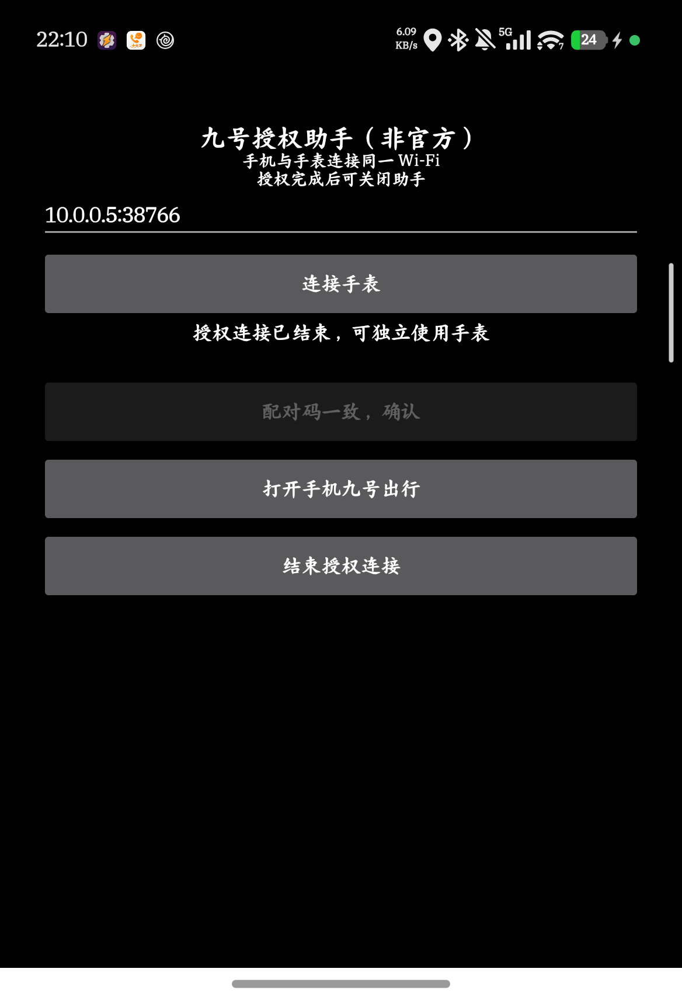

# 九号出行 · Xiaomi Watch 5 适配版

把九号出行手表 APK 适配到国行 Xiaomi Watch 5 的个人移植项目。手表端现在只需安装一个 **九号出行** APK：未登录时直接显示手机配对页，授权成功后进入车辆页，日常用手表自己的网络查看车辆信息。手机端仍需官方九号出行和本项目的**九号授权助手（非官方）**。

> 非九号公司官方项目。测试设备为国行 Xiaomi Watch 5 eSIM 版（Android 14 / API 34、480×480 圆屏、ARM32）与小米手机。已验证的手机官方九号版本为 6.10.12。请从官方渠道安装并登录手机九号出行；本仓库不分发官方手机 APK。

## 实机画面

| 手表：内置授权 | 手表：车辆信息 |
| --- | --- |
|  |  |

| 手机：授权助手 | 手机：官方九号出行 |
| --- | --- |
|  |  |

截图来自当前实机验证；车辆名称和数值只是当时的状态，不代表固定或模拟数据。

## 下载与安装

在 [Releases](https://github.com/sonicmingit/mi-watch5-ninebot/releases) 下载当前版本：

1. **手机**：安装 `ninebot-phone-authorization-v0.5.apk`，同时从官方渠道安装九号出行并登录，确认手机能看到车辆。
2. **手表**：安装 `ninebot-watch-unified-v0.0.9-port6.apk`。已有本项目旧版时可同签覆盖；需要先从电脑用 ADB 安装手表 APK，安装后日常授权不需要电脑。
3. 手机和手表连接同一 Wi-Fi。手机官方九号保持登录。

手表无线调试安装示例：先在手表开发者选项中开启无线调试；如是首次连接电脑，按手表提示用 `adb pair IP:配对端口` 输入**无线调试配对码**。再用手表无线调试主页面的连接端口执行：

```powershell
adb connect 手表IP:无线调试连接端口
adb devices -l
adb -s 手表IP:无线调试连接端口 install --no-incremental -r .\ninebot-watch-unified-v0.0.9-port6.apk
```

`adb devices -l` 应显示手表为 `device`。电脑同时连接手机时，务必用 `-s` 选手表。**无线调试端口仅用于电脑安装，与下一节的授权端口不同。**

## 首次登录与重新授权

1. 打开手表 **九号出行**。未登录时会出现内置“九号手表授权”页，点 **开始配对**。
2. 打开手机 **九号授权助手（非官方）**，填写手表授权页显示的完整地址，点 **连接手表**。授权端口固定为 **38766**；例如手表显示 `10.0.0.5:38766`，手机就填这一整串。IP 以手表当时显示的为准。
3. 仔细比较两端**完整配对码**，完全一致后在两端分别点 **配对码一致，确认**。手表可能要向下滑动才能看到确认按钮。
4. 手机助手提示连接成功后点 **打开手机九号出行**，让已登录的官方应用在前台。手表接收授权后会自动进入车辆页面。
5. 等待手表显示自己的车辆、电量和续航。完成后可结束授权连接、关闭两端助手；以后打开手表九号可独立查看车辆，仍需手表自身有网络。

要主动重新授权：在手表车辆页向下滑，点 **退出登录 → 确认退出**；应用会关闭并清除手表登录凭据。重新打开九号出行，按上面的步骤操作。手机官方九号的登录不受手表退出影响。

**不要把无线调试端口填到手机授权助手。**实机误填调试端口会出现 `SSLHandshakeException`；授权助手应填手表配对页的 `:38766` 地址。配对监听约 5 分钟、确认约 2 分钟，超时后从手表“开始配对”重新来。安装或更新手机助手后若官方九号仍连接旧服务，正常关闭并重新打开手机官方九号再试。

## 旧双应用方案

旧方案需要手表同时安装九号出行和单独的手表授权助手。它作为回退保留在 Release 资产与 [`legacy/`](legacy/README.md)；当前日常使用推荐上面的单包版。若单包版遇到问题，可同签覆盖安装 `ninebot-watch-legacy-restore-v0.0.9-port5.apk`，再安装 `ninebot-watch-authorization-v0.5.apk`，按 [双应用说明](legacy/README.md)授权。恢复包的版本码为 90006，仅用于从单包版 90005 保留数据覆盖回退。

## 开发与验证

[`src/watch/`](src/watch/) 是单包的补丁构建脚本与内置授权 UI；[`src/bridge/`](src/bridge/) 是手机与手表复用的局域网配对通信；[`src/phone/`](src/phone/) 包含手机助手清单和图标；`legacy/` 保留旧版构建增量。生成文件和个人测试结果由 [`.gitignore`](.gitignore) 排除。

构建单包需要合法取得的 port5 基础 APK，放在 `inputs/ninebot-port5.apk`；脚本会核对固定 SHA-256。它还需要 JDK 17、Android SDK Build Tools、`android.jar` 和与基础 APK 相同的签名密钥。设置 `JAVA_HOME`、`ANDROID_BUILD_TOOLS`、`ANDROID_JAR`、`NINEBOT_KEYSTORE`、`NINEBOT_KEY_ALIAS`、`NINEBOT_KEYSTORE_PASSWORD`、`NINEBOT_KEY_PASSWORD` 后运行 `python src/watch/build_port6_unified.py`。签名密钥和基础 APK 不提交到 Git。构建脚本会核对输出签名与基础 APK 相同。

实机已验证：无令牌自动进入内置授权页；同 Wi-Fi 配对、官方手机九号回传账号与手表令牌；手表自动进入车辆页；停止两端助手后冷启动，车辆列表两路请求成功、1 辆车、零错误，真实电量与续航可见。退出登录的凭据清理和取消确认也已验证。当前没有用本项目执行车辆控制命令。证据与边界见 [`docs/PORT6_UNIFIED.md`](docs/PORT6_UNIFIED.md)。

本项目移植的九号客户端及品牌资源属于各自权利人；仓库只存放本次适配的增量源码、说明和截图。APK 仅供设备所有者按相关许可和法律要求自行使用。
