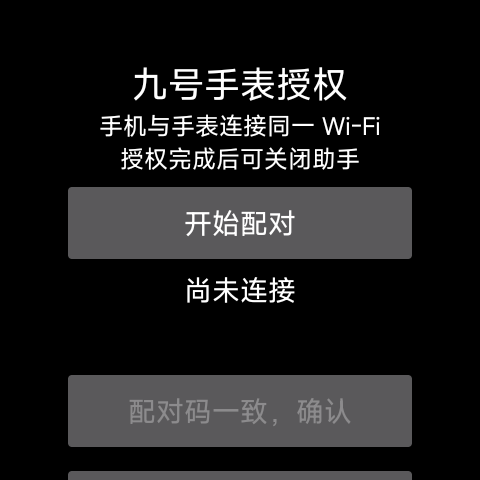

# 九号出行手表版

适用于国行 Xiaomi Watch 5 的非官方九号出行适配版。授权后，手表可独立联网查看车辆状态、行驶速度、剩余电量和里程。

通用版向所有符合使用条件的用户开放。使用时需要兼容的九号账号和车辆、可联网的手表，以及安装了官方九号出行的 Android 手机。手机九号出行 6.10.12 已验证。

## 下载与安装

在 [最新 Release](https://github.com/sonicmingit/mi-watch5-ninebot/releases/latest) 下载一个手表 APK 和手机授权助手。

| 文件 | 安装设备 | 用途 |
| --- | --- | --- |
| `watch.apk` | 手表 | **通用正式版，推荐日常使用。** 没有测试菜单。 |
| `watch-test.apk` | 手表 | **90019 测试版。** 车辆页底部的「测试数据」可查看车辆状态测试和速度测试。 |
| `phone.apk` | 手机 | 九号授权助手。首次授权或重新授权时使用。 |

1. 手机从官方渠道安装九号出行并登录，再安装 `phone.apk`。
2. 手表打开「无线调试」，选择「使用配对码配对设备」。在电脑运行 `adb pair 手表IP:配对端口`，按提示输入手表显示的配对码。回到无线调试主页面，使用该页的端口运行 `adb connect 手表IP:调试端口`。
3. 运行 `adb -s 手表IP:调试端口 install -r watch.apk` 安装通用版。需要测试菜单时，把文件名换成 `watch-test.apk`。
4. 手表只需安装一个版本。已有同签名版本时，可用覆盖安装保留登录。

## 使用方法

1. 手机和手表连接同一 Wi-Fi，确认手机官方九号出行已登录。
2. 打开手表九号出行，点 **开始配对**。
3. 打开手机授权助手，输入手表显示的完整地址，点 **连接手表**。
4. 核对两端配对码，完全一致后在手机和手表上分别点 **确认**。
5. 在手机助手点 **打开手机九号出行**。手表收到授权后会自动显示车辆。

授权成功后可以关闭手机授权助手。日常直接打开手表九号出行，驻车时首页显示电量和里程，行驶时突出显示速度。

需要重新授权时，在手表车辆页向下滑，点 **退出登录 → 确认退出**，重新打开手表九号并重复以上步骤。

**手机助手填手表应用配对页显示的 `IP:38766`。电脑安装 APK 时使用系统「无线调试」页面的地址和端口。**

## 截图

| 手机官方九号出行 | 手机授权助手 |
| --- | --- |
|  |  |

旧双应用方案保存在 [`legacy/`](legacy/README.md)，供需要回退时查阅。手机官方九号 APK 不随本项目发布。
