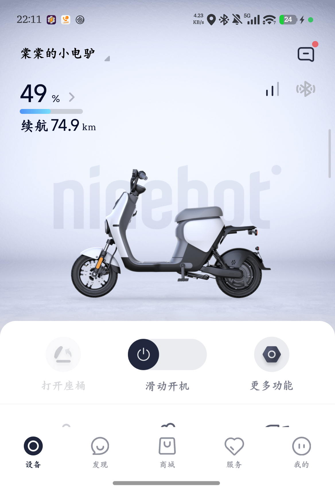

# 九号出行手表版

适用于国行 Xiaomi Watch 5。手表只安装一个九号出行；手机安装官方九号出行和本项目的授权助手。授权后，手表可以用自己的网络查看车辆、电量和续航。

这是非官方适配版。已在 Xiaomi Watch 5 和手机九号出行 6.10.12 上测试。

## 下载

从 [最新 Release](https://github.com/sonicmingit/mi-watch5-ninebot/releases/latest) 下载两个文件：

1. 手机安装 **`九号授权助手-手机.apk`**。手机还需要从官方渠道安装九号出行并登录。
2. 手表安装 **`九号出行-手表.apk`**。手表 APK 可通过无线调试使用 ADB 安装：`adb -s 手表IP:调试端口 install -r 九号出行-手表.apk`。

## 使用方法

1. 手机和手表连接同一 Wi-Fi，确认手机官方九号出行已登录。
2. 打开手表九号出行，点 **开始配对**。
3. 打开手机授权助手，输入手表显示的完整地址，点 **连接手表**。
4. 核对两端配对码，完全一致后在手机和手表上分别点 **确认**。
5. 在手机助手点 **打开手机九号出行**。手表收到授权后会自动显示车辆。

授权成功后可以关闭手机授权助手。以后直接打开手表九号出行查看车辆信息；手表需自行联网。

需要重新授权时，在手表车辆页向下滑，点 **退出登录 → 确认退出**，重新打开手表九号并重复以上步骤。

**手机助手填写手表配对页显示的地址，端口为 `38766`。无线调试端口只用于电脑安装 APK，不能填在手机助手里。**

## 截图

| 手机官方九号出行 | 手机授权助手 |
| --- | --- |
|  |  |

| 手表配对页 | 手表车辆页 |
| --- | --- |
|  |  |

旧双应用方案保存在 [`legacy/`](legacy/README.md)，供需要回退时查阅。手机官方九号 APK 不随本项目发布。
